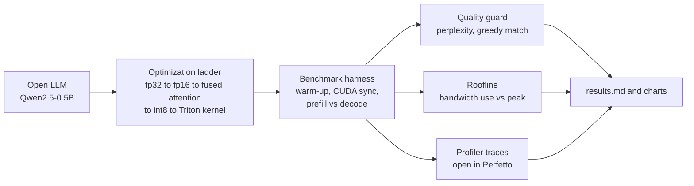
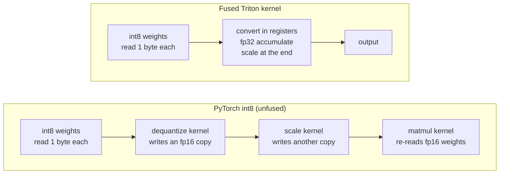
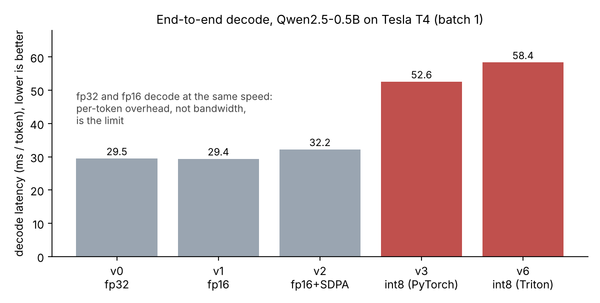
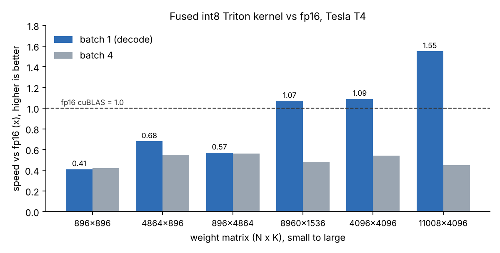

# inferlab-pytorch: LLM inference optimization lab

A small, reproducible PyTorch study of **why LLM decoding is slow and what actually makes it faster**.
It takes an open LLM and climbs an optimization ladder, measuring every rung for latency, throughput,
memory, achieved memory bandwidth and output quality.

```
v0  fp32, eager attention            baseline
v1  fp16, eager attention            half precision
v2  fp16, SDPA (fused attention)     fused attention kernel
v3  fp16, SDPA, int8 weights         weight-only int8 (written from scratch, see inferlab/quant.py)
v4  fp16, SDPA, torch.compile        static KV cache + compiled forward (CUDA graphs)
v5  fp16, SDPA, int8, compile        everything combined
v6  fp16, SDPA, int8 + Triton kernel fused int8 dequant-GEMV (inferlab/kernels/int8_gemv.py)
```

## How it works



Why a fused kernel: decode reads every weight once per token, so memory traffic is what matters.







## What makes this more than a benchmark script

- **Prefill and decode are measured separately.** Prefill is compute-bound, decode is memory-bound.
- **Model Bandwidth Utilization (MBU).** Each decode step streams all weights once, so
  `MBU = bytes_of_weights x tokens/s / peak_DRAM_bandwidth`. This tells you how close a variant is to the
  hardware roofline instead of just "it got faster".
- **Quality guard.** Every variant reports perplexity and greedy-token agreement with the baseline, so a
  speedup is never bought with silent accuracy loss.
- **Profiler traces.** `--profile v2,v5` exports Perfetto traces and a top-kernel table for prefill and decode.
- **A custom Triton kernel that fixes a real problem.** Plain-PyTorch int8 dequantizes in a separate kernel,
  which materializes a full fp16 weight in DRAM (and a second one when the scale is applied) before the matmul
  re-reads it: several times the traffic of plain fp16, so it can be *slower* than fp16 despite smaller weights. `inferlab/kernels/int8_gemv.py` reads each int8 weight
  once, converts in registers, accumulates in fp32 and applies the scale in the epilogue (~1 byte per weight).
  Ceiling: ~2x over fp16 for the weight-bound part of decode.
- **Backend agnostic.** Uses only `torch.cuda` APIs, which map to HIP on AMD ROCm builds of PyTorch. The same
  command runs on an AMD Instinct/Radeon GPU, and `--peak-bw` lets you supply that part's bandwidth.

## Run it (Google Colab, T4)

```bash
pip install -r requirements.txt
python -m inferlab.cli --model Qwen/Qwen2.5-0.5B --prompt-len 256 --new-tokens 64 --profile v2,v5
```

T4 notes: it has no native bf16, so the default is fp16. Stay at <= 1.5B parameters for the fp32 baseline
(`Qwen/Qwen2.5-1.5B` needs ~6 GB for v0). Outputs go to `results/`: `results.json`, `results.md`, `summary.png`,
and `traces/*.json` (open at https://ui.perfetto.dev).

Kernel-level microbenchmark (the cleanest evidence for the kernel claim; GPU required):

```bash
python -m inferlab.kernel_bench      # writes results/kernel_bench.md and .json
```

It compares fp16 cuBLAS, unfused int8 and the fused kernel on matrix shapes from real models (Qwen 0.5B/1.5B,
Llama-7B class) at M=1 and M=4, reporting time, effective GB/s, % of peak bandwidth and error vs fp32.

Offline smoke test (no downloads, runs on CPU): `python -m inferlab.cli --model tiny-random`
Tests: `pytest -q`

## Verification status

- Correctness: kernel logic (masking for non-multiple shapes, bias, batch rows, fp32 accumulation, large
  activations) is unit-tested in Triton's CPU interpreter and on GPU: `python -m pytest -q`.
- Performance: measured on a Tesla T4 (Colab, 15.6 GB, peak DRAM 320 GB/s), Qwen2.5-0.5B, prompt 256, 64 new
  tokens, batch 1, median of 5 runs after 3 warm-ups. Raw outputs are in `results/`.
- Not yet reported: v4/v5 (`torch.compile`). See finding 5.

## Results

### End-to-end decode (Qwen2.5-0.5B, T4)

| variant | weights (GB) | prefill (ms) | decode (ms/tok) | tok/s | vs v0 | peak mem (GB) | MBU % | perplexity | greedy match |
|---|---|---|---|---|---|---|---|---|---|
| v0 fp32, eager attention | 1.98 | 52.7 | 29.48 | 33.9 | 1.00x | 2.02 | 20.9 | 16.19 | 1.000 |
| v1 fp16, eager attention* | 0.99 | 31.8 | 29.39 | 34.0 | 1.00x | 1.02 | 10.5 | 16.19 | 1.000 |
| v2 fp16, SDPA | 0.99 | 37.2 | 32.22 | 31.0 | 0.91x | 1.02 | 9.6 | 16.19 | 1.000 |
| v3 fp16, int8 (PyTorch dequant) | 0.63 | 62.6 | 52.59 | 19.0 | 0.56x | 0.67 | 3.7 | 16.18 | 1.000 |
| v6 fp16, int8 + fused Triton kernel | 0.63 | 63.7 | 58.38 | 17.1 | 0.50x | 0.67 | 3.4 | 16.18 | 1.000 |

\*v1 comes from an earlier run in the same session on the same machine.
Quality is preserved: int8 perplexity is 16.178 vs 16.189 for fp16 and all 64 greedy tokens match.

### Kernel microbenchmark (single linear layer, T4)

| shape | N x K | M | fp16 (ms) | unfused int8 (ms) | fused int8 (ms) | fused vs fp16 | fused vs unfused | fused GB/s | % peak | rel err |
|---|---|---|---|---|---|---|---|---|---|---|
| qwen0.5B q_proj / o_proj | 896x896 | 1 | 0.041 | 0.1085 | 0.1001 | 0.41x | 1.08x | 8.0 | 2.5 | 0.0079 |
| qwen0.5B q_proj / o_proj | 896x896 | 4 | 0.0427 | 0.0985 | 0.1008 | 0.42x | 0.98x | 8.0 | 2.5 | 0.00768 |
| qwen0.5B mlp up/gate | 4864x896 | 1 | 0.0664 | 0.261 | 0.0971 | 0.68x | 2.69x | 44.9 | 14.0 | 0.0078 |
| qwen0.5B mlp up/gate | 4864x896 | 4 | 0.0675 | 0.2563 | 0.1229 | 0.55x | 2.09x | 35.5 | 11.1 | 0.00773 |
| qwen0.5B mlp down | 896x4864 | 1 | 0.0614 | 0.2483 | 0.1085 | 0.57x | 2.29x | 40.2 | 12.5 | 0.00915 |
| qwen0.5B mlp down | 896x4864 | 4 | 0.0679 | 0.2542 | 0.1208 | 0.56x | 2.1x | 36.1 | 11.3 | 0.00899 |
| qwen1.5B mlp up/gate | 8960x1536 | 1 | 0.1393 | 0.8523 | 0.1307 | 1.07x | 6.52x | 105.3 | 32.9 | 0.00815 |
| qwen1.5B mlp up/gate | 8960x1536 | 4 | 0.1453 | 0.8491 | 0.3048 | 0.48x | 2.79x | 45.2 | 14.1 | 0.00809 |
| llama7B-class qkv/o | 4096x4096 | 1 | 0.1567 | 1.0412 | 0.1444 | 1.09x | 7.21x | 116.2 | 36.3 | 0.00848 |
| llama7B-class qkv/o | 4096x4096 | 4 | 0.1815 | 1.0481 | 0.3341 | 0.54x | 3.14x | 50.2 | 15.7 | 0.0086 |
| llama7B-class mlp up | 11008x4096 | 1 | 0.381 | 2.8375 | 0.2457 | 1.55x | 11.55x | 183.5 | 57.3 | 0.00862 |
| llama7B-class mlp up | 11008x4096 | 4 | 0.4158 | 2.7976 | 0.9206 | 0.45x | 3.04x | 49.0 | 15.3 | 0.00869 |

## Findings

1. **The fused kernel does what it was built for, on large layers at batch 1.** On a 7B-class MLP matrix
   (11008x4096) it is 1.55x faster than fp16 cuBLAS and 11.5x faster than the PyTorch int8 path, at 57% of peak
   bandwidth. Relative error (about 0.8%) is just int8 rounding error.
2. **On small layers it loses to fp16.** For 896x896 the fused kernel takes ~0.10 ms against 0.04 ms for cuBLAS.
   Sub-0.1 ms kernels are dominated by launch cost, and Triton's Python-side launch is heavier than cuBLAS's.
3. **Batch size 4 exposes a design flaw.** The grid launches one program per (output block, activation row), so
   every row re-reads the whole weight matrix. Time scales ~3.7x from M=1 to M=4 on the largest matrix
   (0.246 -> 0.921 ms) and the kernel falls to 0.45x of fp16. Fix: tile over M so each weight tile is read once.
4. **End-to-end decode on this model is not memory-bound.** fp32 and fp16 decode at the same speed
   (29.5 vs 29.4 ms/token) even though fp16 moves half the bytes, and MBU is only 10%. That pattern points to
   per-token overhead (hundreds of small kernel launches driven from Python) rather than DRAM bandwidth. Extra
   int8 launches then make things slower (v3, v6), regardless of how good the kernel is. This is the diagnosis
   from timings; confirming it from the exported traces (GPU idle gaps) is the next check.
5. **`torch.compile` could not use CUDA graphs here.** PyTorch reported "skipping cudagraphs due to mutated
   inputs": Hugging Face's static KV cache updates a counter tensor in place (`cumulative_length.add_`). So the
   standard compile route does not remove the launch overhead for this model and version.
6. **A bug found by measuring.** The first int8 implementation scaled the *output* of an fp16 matmul over raw
   int8 values, which overflowed to NaN on Qwen's large activations. The fix (dequantize before the matmul) has a
   regression test. The fused kernel is immune because it accumulates in fp32.

## Roadmap (not yet done)

- Tile the kernel over M so weights are read once per tile (fixes finding 3).
- Cut per-call launch overhead (cache the autotuned config, avoid extra tensor ops in the wrapper).
- Capture the decode step manually with `torch.cuda.CUDAGraph` and a static cache, which attacks finding 4.
- Larger model (1.5B-7B) where weights dominate, plus the same benchmark on an AMD GPU (ROCm).
- Int4 (packed) variant and group-wise scales; ExecuTorch / ONNX export for on-device targets.

## Layout

```
inferlab/kernels/      Triton fused int8 dequant-GEMV (autotuned; runs in Triton's CPU interpreter for tests)
inferlab/kernel_bench.py  per-op microbenchmark: fp16 vs unfused int8 vs fused int8
inferlab/quant.py      int8 per-channel weight-only quantization + Int8WeightOnlyLinear
inferlab/variants.py   the optimization ladder and model loading
inferlab/bench.py      sync-correct prefill/decode timing, memory, MBU
inferlab/profile.py    torch.profiler traces + top-kernel tables per phase
inferlab/quality.py    perplexity and greedy-agreement checks
inferlab/hardware.py   device info and peak-bandwidth table (NVIDIA + AMD)
inferlab/report.py     markdown table + chart
tests/                 unit tests for quantization + offline end-to-end smoke test
```
